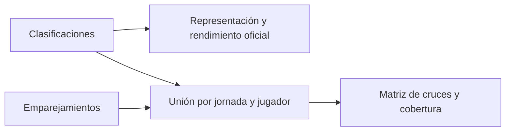

# Crown of Spain · Análisis de datos de Pokémon TCG

> Pokémon TCG analytics dashboard covering 13 tournaments, 1,015 unique players, 1,788 tournament entries, and 4,380 matches. Uses Limitless data to analyze deck popularity, win rates, and head-to-head performance.

[Visitar la web de Crown of Spain](https://crown-of-spain.caartagena.chatgpt.site)

Crown of Spain convierte las clasificaciones y los cruces de un circuito competitivo de Pokémon TCG en un panel de análisis. El panel permite seguir la evolución de los tipos de mazo, comparar su rendimiento por rival y consultar resultados por jornada, jugador y país.

**Pregunta de análisis.** ¿Los mazos más usados mantienen su rendimiento entre jornadas y frente a distintos rivales?

**Corte histórico del análisis.** 11 jornadas de formato suizo BO1, del 7 de julio al 13 de octubre de 2026. El conjunto de datos, guardado el 16 de octubre de 2026, reúne **1.559 participaciones**, **938 jugadores únicos** y **3.806 cruces con dos jugadores y resultado válido**. Una misma persona puede contar como participación en varias jornadas.

## Hallazgo · Dragapult en la jornada 11

Dragapult fue el arquetipo más usado en la jornada 11, con **20 de 175 participaciones (11,43 %)**. Su cuota de uso fue similar a la de las diez jornadas anteriores, mientras que su porcentaje oficial de victorias subió **10,69 puntos porcentuales** respecto a ese período.

| Período | Participaciones con Dragapult | Representación | Victorias–derrotas–empates | Rondas puntuadas | Victorias |
| --- | ---: | ---: | ---: | ---: | ---: |
| Jornadas 1–10 | 167 de 1.384 | 12,07 % | 361–427–2 | 790 | 45,70 % |
| Jornada 11 | 20 de 175 | 11,43 % | 53–40–1 | 94 | 56,38 % |

La media de la jornada oculta diferencias entre rivales. Dragapult ganó **5 de 5** cruces frente a Dragapult Blaziken y **2 de 7** frente a Slowking. En el conjunto de las 11 jornadas ganó **30 de 54** y **18 de 53**, respectivamente. El 100 % de la jornada 11 sale de solo cinco cruces. Para valorar ese resultado conviene mostrar el tamaño de la muestra junto al porcentaje y consultar un período más amplio. Las diferencias son descriptivas y pueden reflejar cambios en los rivales o en quién usa cada mazo.

[Ver la jornada 11 en Crown of Spain](https://crown-of-spain.caartagena.chatgpt.site/#jornadas/6ac51e2b245696afb351798d). Abre la pestaña **Metajuego** y selecciona **Dragapult** para consultar sus cruces.

## Del dato de origen al indicador

El histórico usa la [API pública de torneos de Limitless](https://docs.limitlesstcg.com/developer/tournaments). La clasificación aporta una fila por jugador y jornada, con su posición, récord oficial y arquetipo cuando está disponible. Los emparejamientos aportan una fila por cruce, con los participantes y el resultado. El panel relaciona ambos conjuntos mediante el identificador de la jornada y el usuario estable de Limitless, de modo que un cambio de nombre visible conserva el historial del jugador.

| Indicador | Cálculo y unidad de análisis |
| --- | --- |
| Representación | Participaciones con el arquetipo ÷ todas las participaciones del período. |
| Porcentaje oficial de victorias | Victorias oficiales ÷ (victorias + derrotas + empates). Se suman primero los recuentos de cada participación. Los byes y las penalizaciones se reflejan según la clasificación oficial. |
| Rendimiento frente a otro mazo | Victorias del mazo de la fila ÷ resultados válidos de ese mazo frente al de la columna. Requiere dos jugadores y dos arquetipos identificados. En un cruce espejo se cuenta una partida y se registran los resultados de ambos lados. |
| Tamaño de muestra | Partidas con dos jugadores y resultado válido. Los indicadores destacados de mejor porcentaje exigen al menos 20 partidas de este tipo. |

Un *bye* es una ronda que se acredita sin rival. Los empates se guardan como una categoría propia y las dobles derrotas cuentan como derrota para ambos jugadores. Los cruces pendientes y los resultados inválidos quedan fuera de las comparaciones. Si una pareja de mazos carece de enfrentamientos válidos, el panel muestra «Sin cruces».

## Calidad y límites de los datos

- **Cobertura de la matriz.** De los 3.806 cruces válidos, **3.699 (97,19 %)** tenían un arquetipo identificado en ambos lados. Los otros 107 se contabilizaron aparte. El porcentaje describe la cobertura de ese corte.
- **Validación.** Los totales se volvieron a calcular sobre el corte histórico. Las pruebas automatizadas cubren la conciliación de cruces, los empates, los byes, los espejos, los cambios de nombre y las jornadas incompletas. Una prueba contrasta el récord de Dragapult en la jornada 11 con el resultado oficial.
- **Datos incompletos.** Una jornada suiza entra en el histórico cerrado cuando hay primer puesto y las rondas previstas tienen resultados publicados. Si falla la fuente externa, el panel identifica los datos parciales o desactualizados y puede utilizar el último histórico disponible.
- **Alcance.** Los resultados describen el circuito analizado. El formato BO1, los tamaños de muestra y la composición de cada jornada condicionan la comparación. El país se toma del registro de cada jornada y el análisis entre países usa únicamente cruces internacionales con ambos países informados.

## Trabajo del proyecto

Integración de una API pública, modelado de participaciones y cruces, definición de métricas, comprobaciones de calidad y visualización en un panel con filtros por período y tamaño de muestra. El análisis y el panel se implementaron en TypeScript y React. El código de la aplicación se conserva en un repositorio privado.
